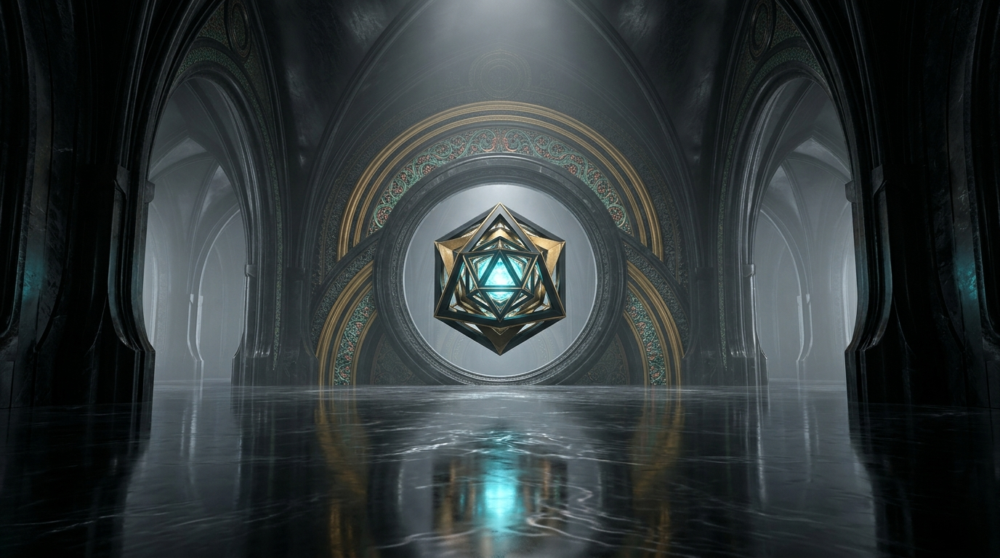

# THE SPACE THAT NOTICES YOU



A zero-dependency, immediately runnable real-time WebGL2 interactive spatial artwork interpreting the initiatory N,N-DMT encounter—a threshold crossed, an impossibly inhabited space, reciprocal attention, nonverbal geometric transformation, and an echoed return.

## Highlights

- **Emergent 5D Dodecahedral Spatial Geometry (`src/shaders.js`)**: Real-time GLSL ES 3.00 raymarching built around golden-ratio dodecahedral (`H3`) Coxeter folding lifted through 4D/5D `(w, v)` Clifford rotations, unfolding into layered 3D crystalline chrysanthemums with off-axis raking shadows, single-bounce volcanic obsidian floor reflections, and ACES Filmic luminance control.
- **Impossible Relic & Emergent Presence**: A hollow 30-edge forged-gold dodecahedron enclosing a counter-rotating nested dodecahedron and a 5D non-Euclidean interior sanctuary; an articulated angular polyhedral Presence emerging out of the same vaulted grammar that tracks sustained gaze.
- **Optional Spatial Web Audio (`src/audio.js`)**: Muted by default; gesture-enabled stereo obsidian pad, generative D-Lydian crystalline lattice, reciprocal-attention formant choir, tactile Relic chimes, stillness overtones, and Resonant Fold tension/release chords.
- **Explicit State-Machine Architecture (`src/stateMachine.js`)**: Pure, DOM-free state controller coordinating transport, mutually exclusive surfaces (`interactive` / `guide` / `capture`), 18s HD recording with stereo audio (MP4 where supported, WebM fallback), pointer/Space gesture arbitration, serialized async audio, aspect framing, and WebGL context recovery—paired with `window.__SPACE_APP__` and semantic `<html>` `data-*` attributes.
- **Peripheral Discovery Guide (`src/guideData.js`)**: Dismissible *"What am I seeing?"* drawer distinguishing reported motifs, screen-based artistic inventions, and unresolved interpretations, with verifiable primary DOI citations.
- **Sharing & Capture**: Clean Capture Mode (`C`), deterministic seamless 18-second Showcase Loop (`L`), `Full` / `16:9` / `9:16` framing, PNG Still (`S`), and synchronized 18s HD recording with stereo audio (MP4 where supported, WebM fallback).

## Quick Start

Serve the directory over localhost (required for ES modules and WebGL texture uploads):

```bash
python -m http.server 8742
```

Then open **http://localhost:8742/** in any modern browser. *(Alternative: `npx serve -l 8742 .`)*

## Tests

```bash
npm test
```

## Controls

- **Move pointer / touch**: Guide gaze; hold steadily for **Attention Returned**; rest hands for the **Stillness Layer**.
- **Drag**: Rotate the Impossible Relic in 3D space.
- **Scroll / Pinch / Double-click / `U`**: Unfold the Relic's 5D dodecahedral shells and peer inside its nested sanctuary.
- **Press & Hold (or hold `Space`) → Release**: **Resonant Fold** — bends space inward, then releases a spherical inversion wave that weaves a lasting harmonic into the chamber.
- **Shortcuts**: `1`–`5` jump phases · `P` pause · `R` return · `L` 18s loop · `C` clean capture · `S` PNG still · `A` audio · `K` stabilize camera · `M` reduced motion · `?` / `I` guide · `Esc` dismiss.

## Capture a clip for X

Open **Capture**, choose your framing, then record the 18-second loop. Recording locks the render to native HD resolution and includes the generated stereo soundtrack when Web Audio is available. MP4 is preferred; browsers without MP4 recording support fall back to WebM. Use **PNG Still** for an image, or press **S**.
